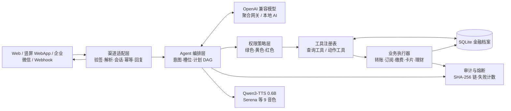

# 众安 AI Banking Agent 技术方案总览

## 1. 产品目标

本项目把手机银行的深层菜单改造成可对话的 AI Banking Agent。用户可以通过 Web、手机竖屏界面、通用 Webhook 或企业微信描述金融意图，Agent 先查询账户事实，再生成任务计划，经过服务端权限判定后执行查询或银行业务动作，并返回可解释的执行回执。

演示账户、银行卡、交易、订阅、贷款和理财产品全部来自 SQLite 生成数据；数据结构按照真实银行账户关系组织，便于后续替换为真实银行接口。项目当前主要展示众微银行主账户、工资卡、信用卡、绑定微信支付、微粒贷和众微银行金融产品。

## 2. 系统架构



### 2.1 层职责

| 层 | 职责 | 关键实现 |
|---|---|---|
| 渠道适配 | 将平台消息转换为统一 Envelope，处理验签、幂等和回复格式 | `/channel/message`、`/channel/wecom/callback` |
| Agent 编排 | 识别意图、补齐槽位、生成任务计划、管理暂停和恢复 | `handleAgent()`、`detectActionSteps()`、`runActionSteps()` |
| 权限策略 | 按节点计算绿色/黄色/红色，签发确认或强验证票据 | `stepSecurityLevel()`、`decisionForStep()` |
| 工具注册 | 只暴露白名单查询和动作工具 | `TOOL_DEFS`、`ACTION_TOOL_DEFS` |
| 数据层 | 提供账户树、200 条三个月流水、订阅、贷款和理财数据 | `db.mjs`、`data/finance.sqlite` |
| 执行层 | 校验账户归属、余额、密码、额度和业务状态后写库 | `executeAgentStepInner()`、`executeTransfer()` |
| 审计层 | 记录意图、计划、决策、执行和错误 | `writeAudit()`、`listAudit()` |

## 3. 五大银行功能与服务入口

功能页面保持独立路由，AI 对话只负责理解和调用，不把银行功能堆到对话首页。

| 顶层入口 | 页面路由 | 展示能力 |
|---|---|---|
| 账号 | `#/accounts`、`#/accounts/:id` | 银行卡列表、账户详情、余额、额度、卡片服务和逐条流水 |
| 资产 | `#/assets` | 总资产、总负债、净资产、可用授信、众微银行账户树和资产下钻 |
| 收支 | `#/cashflow`（旧 `#/transactions`、`#/bills` 仅兼容） | 三个月 200 条流水、月份折叠、平台/方向/分类/日期筛选、账单分析 |
| 贷款 | `#/loans` | 贷款产品、额度测试、贷款账户、还款与申请流程 |
| 理财 | `#/wealth` | 产品目录、收益率、风险等级、详情与申购；赎回接口预留未开放 |
| 服务 | `#/payments`、`#/subscriptions` | 预支付项、订阅管理、生活缴费、定时转账和服务回执 |

账号是银行卡管理入口，资产是总览入口；备用金是储蓄目标，不作为可支付账户余额；微信支付只作为绑定对象或扣款来源；信用卡作为负债和支付来源存在。

## 4. Agent 核心算法

### 4.1 意图识别

输入文本先经过归一化、注入特征检测和规则预路由。规则层负责金额、手机号、日期、商户、页面上下文和已知账户抽取；模型层只在规则不确定或需要上下文推断时生成结构化 JSON。

```ts
type Intent = {
  name: 'balance' | 'cashflow' | 'transaction' | 'subscription'
    | 'card' | 'transfer' | 'bill' | 'wealth' | 'loan'
    | 'pay_bill' | 'cancel_subscription' | 'set_policy' | 'other';
  confidence: number;
  slots: Record<string, string | number | boolean>;
  missing: string[];
  evidence: Array<{ source: string; field: string; value: string }>;
  source: 'rule' | 'model';
};
```

模型不得直接执行数据库写操作，不得直接声称转账或扣款成功。模型结果必须经过 JSON 结构、工具白名单、参数边界、账户事实和权限策略五层校验。

### 4.2 槽位补齐

缺少关键参数时保存会话草稿，只追问一个最关键的问题。例如“帮我转账”先追问收款人，“转给小王”再追问金额。用户补充金额后合并原草稿，重新计算计划摘要和权限级别。

### 4.3 任务 DAG

多动作请求拆成有依赖关系的节点：

```text
关闭爱奇艺续费并开启腾讯视频续费
  n1 查询爱奇艺当前订阅       green
  n2 关闭爱奇艺自动续费       yellow，依赖 n1
  n3 查询腾讯视频产品         green
  n4 开启腾讯视频自动续费     yellow，依赖 n3
```

每个节点拥有 `id`、`dependsOn`、`tool`、`args`、`level`、`state` 和 `evidenceRefs`。查询节点先产生证据，动作节点引用证据；节点失败时后续依赖节点不执行。

### 4.4 执行状态机

```text
RECEIVED → NORMALIZED → INTENT_RESOLVED → SLOTS_FILLED
  → PLAN_PREVIEWED → POLICY_CHECKED
  → WAITING_CONFIRM / WAITING_STRONG_AUTH → EXECUTING
  → COMPLETED / PARTIAL_FAILED / CANCELLED / CIRCUIT_OPEN
```

用户取消只取消尚未执行的节点；已经完成的节点保留结果。每个动作有幂等键，企业微信重复回调、浏览器重复提交和刷新页面不会产生第二笔资金动作。

## 5. 权限分级与安全机制

| 级别 | 执行规则 | 示例 |
|---|---|---|
| 绿色 | Agent 确认意图后自动执行 | 余额、流水、账单、收益和订阅查询 |
| 黄色 | 展示计划，等待用户确认 | 小额转账、取消订阅、卡片锁定、生活缴费 |
| 红色 | 强验证后执行 | 大额转账、密码修改、卡片挂失、理财申购赎回、自动批准策略变更 |

策略函数同时检查基础风险、金额、日累计、收款人、目标账户归属和可逆性。完全权限只影响前端进入执行预览，不能绕过红色强验证。

确认票据绑定：

```text
userId + channel + sessionId + planId + nodeId + tool + argsDigest + expiresAt
```

票据过期、跨用户、跨会话、参数改变或重复使用都会失败。密码只在 Web/App 的密码卡输入，企业微信和 Webhook 只返回确认链接。

安全机制包括工具白名单、注入拦截、支付密码失败计数、SHA-256 审计链、连续失败熔断、查询与资金写操作分离、计划中断和人工接管。

## 6. IM 接口契约

IM 适配器按《IM 技术准备稿（定稿）》的统一 Envelope 与票据契约实现，并通过 55 条专项验收；真实企业微信联调需企业凭据。

通用 Webhook：

```http
POST /channel/message
Content-Type: application/json
X-Idempotency-Key: provider-message-id
```

企业微信：

```text
GET  /channel/wecom/callback  → 回调验签与 echostr
POST /channel/wecom/callback  → XML 解密、用户映射、Agent 调用
POST https://qyapi.weixin.qq.com/cgi-bin/message/send
```

适配器只负责收、转、发。企业微信使用 `wecom:{userId}` 或 `wecom:group:{chatId}:{userId}` 作为会话，`MsgId` 作为幂等键，长任务通过 `message/send` 异步回执。待确认操作通过短链接回到 Web/App，IM 不接收支付密码。

## 7. 数据模型与模拟档案

SQLite 包含众微银行主账户、工资卡、储蓄卡、信用卡、微信绑定对象、账户容器、200 条三个月逐笔流水、固定订阅、预支付项、贷款账户、理财产品、持仓、操作审计、策略和渠道绑定表。

## 8. 语音与 AI 服务

AI 对话使用 OpenAI 兼容接口；TTS 优先连接 Qwen3-TTS 0.6B 本地服务 `127.0.0.1:7861`，默认 Serena 音色，支持中文自然语言语气指令和 9 个官方音色。服务未就绪时按项目回退链处理，语音入口不影响银行操作状态。

## 9. 评审可运行路径

```powershell
cd "参赛方案_资金安全管家"
npm install
npm run db:check
npm start
```

默认页面：`http://localhost:4173`。主要检查：`npm run check`、`npm run smoke`、`npm run db:check`。部署、端口、环境变量、数据重置和材料打包见 `../03-源代码与部署材料/README.md`。

详细的票据、DAG、企业微信验签、熔断和验收清单见 [权限规划与 IM 技术准备稿.md](./权限规划与%20IM%20技术准备稿.md)；IM 渠道的完整定稿、实现落点与 55 条用例见 [IM_TECHNICAL_PREPARATION.md](../../IM_TECHNICAL_PREPARATION.md)。
